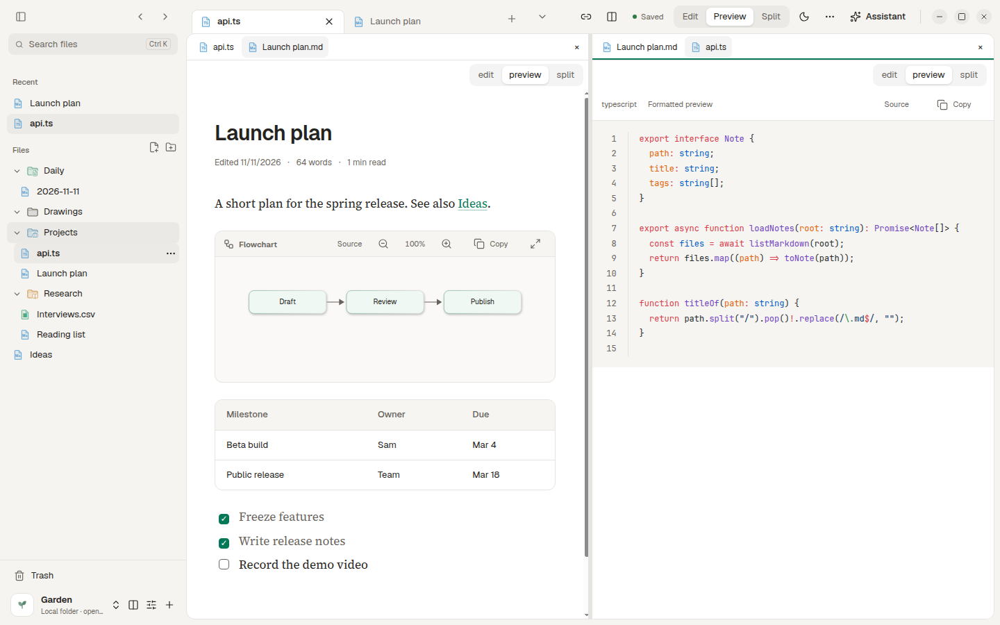

<p align="center"></p>

<h1 align="center">Grove</h1>

A desktop app for your notes, drawings and files. Grove opens a plain folder (a vault) and lets you read, write and preview Markdown, Excalidraw drawings, PDFs, code, Office documents and media in one place. Claude and Codex can read your notes and propose changes that you accept or reject.

Grove runs on Linux today. Windows is next, and a phone and browser version is on the [roadmap](#roadmap). Grove is an early build. Back up important folders before using it. See [CHANGELOG.md](CHANGELOG.md) for what changed in each version.

<picture>
  <source media="(prefers-color-scheme: dark)" srcset="docs/screenshot-dark.png">
  
</picture>

## Install

### Ubuntu / Debian (apt)

Add the repository once, then install and update with apt:

```bash
sudo mkdir -p /etc/apt/keyrings
curl -fsSL https://dr1tch.github.io/grove/grove.asc | sudo tee /etc/apt/keyrings/grove.asc > /dev/null
echo "deb [signed-by=/etc/apt/keyrings/grove.asc] https://dr1tch.github.io/grove ./" | sudo tee /etc/apt/sources.list.d/grove.list
sudo apt update && sudo apt install folio
```

The package is named `folio` and installs the Grove app. Installers (.deb and AppImage) are also attached to each [GitHub release](https://github.com/dr1tch/grove/releases). Windows installers will be added to the same releases once the Windows port lands.

## Features

### Writing and reading

- Markdown editor with autosave, split editing and a GitHub-style preview: tables, tasks, wikilinks, images, Mermaid diagrams and Excalidraw embeds.
- Formatting toolbar for headings, bold, italic, quotes, code, links, lists and tasks, with undo/redo and Ctrl+B/Ctrl+I shortcuts. Insert from vault reuses existing media, drawings and saved Mermaid source without copying files.
- Real Excalidraw editor. Drawings stay in their original JSON or Obsidian Excalidraw format.
- Code files (Vue, JavaScript, TypeScript and more) with syntax colours and formatted previews. CSV and TSV show as tables.
- HTML and XHTML source beside a safe preview with scripts and network disabled.
- Reading widths, installed fonts, light, dark and system themes, and six accent colours.

### Files and media

- PDF and image previews open fitted and centered, with zoom, page controls and a separate fullscreen window.
- Scroll to zoom images and videos, drag to pan, double-click to fit.
- Word, Excel and PowerPoint previews through LibreOffice, read-only and on a copy.
- Drop files or paste screenshots into a note. They are copied into an `attachments` folder and linked.
- Files with a PDF header open as PDF even with the wrong extension.

### Organising

- Tabs with pins, previews, reopen closed tab and drag to reorder. Two panes side by side.
- Sync a vault between computers through a private GitHub repository (Settings > Sync).
- Ctrl+K file switcher, Ctrl+Shift+F search across notes, code and PDF text, Ctrl+F in the current file.
- Backlinks, broken-link checks and renames that update links.
- Named workspace presets for layouts and open files.
- Export a note as self-contained HTML or PDF.

### Safety

- Atomic writes, version history, a comparison dialog for outside changes and recoverable Trash. Nothing is overwritten without a choice.
- Reads are confined to the vault by the Linux kernel. Snapshots live in `.folio/history/`, deleted files in `.trash/`.
- The Claude and Codex panel uses your signed-in CLIs in an isolated sandbox. It only proposes changes; nothing is written until you accept.

## Build from source

Requirements: Node 22+, [Vite+](https://vite.plus), Python 3 and a Linux kernel with `openat2` and `renameat2`. Bubblewrap is needed for the assistant panel. LibreOffice is optional, for Office previews.

```sh
vp install
node node_modules/electron/install.js
vp check
vp test --run
python3 scripts/vault-races.py
vp run build
vp run package
```

Install the local package with `sudo apt install ./release/folio_<version>_amd64.deb`. Launch Grove from the app grid; Ubuntu's AppArmor sandbox needs the installed package, so do not run an unpacked build with `--no-sandbox`.

UI checks run the real app headless, for example `xvfb-run -a node scripts/smoke.mjs` or `xvfb-run -a node scripts/visual-qa.mjs`. `scripts/readme-screenshot.mjs` regenerates the README screenshots from a demo vault. Some QA scripts expect sample PDFs at local paths; change those paths to your own files.

### Workspaces

The root package remains the Electron app. `packages/core` owns platform-independent file types, classification, icon semantics, links, Markdown formatting, attachments and conflict naming. Desktop imports in `src/shared` re-export those implementations for compatibility. New consumers use the explicit `@grove/core/types`, `/files`, `/file-icons`, `/tree`, `/links`, `/markdown-format`, `/vault-insert`, `/attachments` and `/conflicts` exports. These private packages export TypeScript source for application bundlers; they are not published libraries.

`packages/github-vault` provides the shared SHA-conditional GitHub store, durable text-edit queue and safe conflict copies for future web/phone clients. `apps/web` currently contains only its IndexedDB storage adapter. There is no browser UI or native integration yet, and desktop sync still uses its existing Git CLI implementation. See [the shared vault contract and limits](packages/github-vault/README.md). Run `vp test --run packages/github-vault/src`, the package/web typecheck tasks, and `node scripts/web-cache-qa.mjs` to verify it. The browser QA uses real isolated Chromium storage against a fake repository, never a private vault.

Run `vp check`, `vp test --run` and `vp run build` from the root. Check the core package in isolation with `vp exec tsc --noEmit -p packages/core/tsconfig.json`. Its TypeScript environment excludes Node and browser globals. Vite+ discovers tests under both `src/` and `packages/`. See [the client plan](docs/superpowers/plans/2026-11-12-grove-clients-workspaces.md).

`apps/landing` is the static React/Vite+ landing page. Build it with `vp run '@grove/landing#build'` and check its types with `vp run '@grove/landing#typecheck'`. It outputs to `out/landing` using the `/grove/` project base path. The desktop package includes only `out/main`, `out/preload` and `out/renderer`, so it excludes the landing build. The site uses local fonts, exact Grove logo vectors and a real desktop screenshot. Its phone image is labelled as a design preview; phone and browser apps are not implemented yet.

Start a local landing preview through your registered `devport` command, for example from `apps/landing`: `~/.claude/scripts/devport run landing -- vp preview --host 127.0.0.1 --port '{port}' --strictPort`. Register an unused checkout offset and the `landing` app in `devport` if needed. Then run `GROVE_LANDING_URL=http://127.0.0.1:<port>/grove/ node scripts/landing-qa.mjs` from the root. The QA script uses installed Google Chrome headlessly and checks responsive layouts, keyboard navigation, FAQs, assets and release/source links. Building the landing page does not deploy it or change the APT site.

## Releases

Push a tag like `v0.4.2`. CI checks and tests the code, builds the .deb and AppImage, publishes a GitHub release and updates the signed APT repository. Add the release notes to [CHANGELOG.md](CHANGELOG.md) first.

## Known limits

- Linux only for now. The file layer uses Linux kernel calls, so Windows needs a port of that layer (in progress next).
- Sync needs git and either the gh CLI or SSH access to GitHub.
- PDF search reads existing text only, no OCR. Search speed on PDF-heavy vaults is not measured.
- The assistant cannot yet search the whole vault on its own, see drawings as images, read PDF text or undo accepted proposals.
- Trash and export recovery copies are not cleaned up automatically. Version history is unbounded.
- Large-vault startup and memory use are not measured.

## Roadmap

Windows support, Git sync across desktops, a phone and browser version, and plugins (including a partial Obsidian plugin layer). See [docs/specs/grove-sync-plugins.md](docs/specs/grove-sync-plugins.md).

## License

[MIT](LICENSE)
